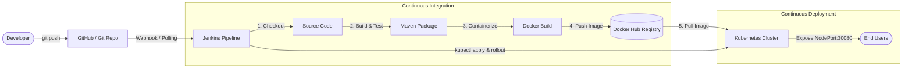

# Automated CI/CD: Deploy Spring Boot on Kubernetes Using Jenkins

This project demonstrates an enterprise-grade Continuous Integration and Continuous Deployment (CI/CD) pipeline for a containerized Java Spring Boot application deployed onto a Kubernetes cluster (e.g., Minikube, Docker Desktop K8s, EKS, or GKE) using Jenkins.

---

## 🏗️ Architecture Overview



---

## 📂 Project Structure

```text
.
├── Jenkinsfile                          # Declarative Jenkins CI/CD pipeline
├── Dockerfile                           # Multi-stage Dockerfile for Spring Boot
├── .dockerignore                        # Docker build context exclusions
├── pom.xml                              # Maven configuration (Java 17, Spring Boot 3.3.4)
├── mvnw / mvnw.cmd                      # Portable Maven Wrapper scripts
├── src/
│   ├── main/
│   │   ├── java/com/example/demo/
│   │   │   ├── DemoApplication.java    # Spring Boot Main Class
│   │   │   └── controller/
│   │   │       ├── HelloController.java# REST Controller with Pod & Node metadata
│   │   │       └── MessageResponse.java# Response DTO record
│   │   └── resources/
│   │       └── application.properties  # Actuator & application properties
│   └── test/                            # Unit & MockMvc tests
├── k8s/
│   ├── deployment.yaml                  # K8s Deployment (Zero-downtime rolling update)
│   ├── service.yaml                     # K8s NodePort Service (Port 30080)
│   └── configmap.yaml                   # Environment configurations
└── jenkins/
    ├── Dockerfile                       # Custom Jenkins image with Docker & kubectl CLI
    └── docker-compose.yml               # Compose file with Docker socket & Kube mounts
```

---

## 🚀 Quick Start Guide

### 1. Prerequisites
- **Docker Desktop** (or Docker Engine)
- **Minikube** (or any Kubernetes cluster)
- **Git**
- **Docker Hub account**

---

### 2. Start Local Kubernetes Cluster (Minikube)
If using Minikube:
```bash
# Start Minikube
minikube start --driver=docker

# Verify cluster status
kubectl get nodes
kubectl cluster-info
```

---

### 3. Run Custom Jenkins with Docker & Kubectl
The `jenkins/` directory provides a pre-configured Docker Compose setup that packages Jenkins with Docker CLI and `kubectl`:

```bash
cd jenkins
docker compose up -d --build
```

Access Jenkins in your browser at: [http://localhost:8080](http://localhost:8080)

To retrieve the initial administrator password:
```bash
docker exec -it jenkins-ci-cd cat /var/jenkins_home/secrets/initialAdminPassword
```

---

### 4. Configure Jenkins

#### A. Install Recommended & Required Plugins
1. Complete the initial setup wizard (choose **Install suggested plugins**).
2. Go to **Manage Jenkins** > **Plugins** > **Available plugins** and install:
   - **Docker Pipeline**
   - **Kubernetes CLI Plugin** (`kubernetes-cli`)
   - **Pipeline: Stage View**

#### B. Configure Credentials
Navigate to **Manage Jenkins** > **Credentials** > **System** > **Global credentials**:

1. **Docker Hub Credentials**:
   - Kind: `Username with password`
   - ID: `dockerhub-credentials`
   - Username: *Your Docker Hub username*
   - Password: *Your Docker Hub access token or password*

2. **Kubernetes Configuration (kubeconfig)**:
   - Kind: `Secret file` (or `Certificate` / `Secret text`)
   - ID: `mykubeconfig`
   - File: Upload your `~/.kube/config` file.
   *(Note: For Minikube, make sure the cluster server URL in the config is reachable from inside Docker, e.g., `https://host.docker.internal:8443` or Minikube's IP).*

---

### 5. Setup the Pipeline Job in Jenkins
1. In Jenkins dashboard, click **New Item**.
2. Enter item name (e.g., `spring-boot-k8s-pipeline`), select **Pipeline**, and click **OK**.
3. In the Pipeline section:
   - **Definition**: Select **Pipeline script from SCM**.
   - **SCM**: Choose **Git**.
   - **Repository URL**: Your Git repository URL.
   - **Branch Specifier**: `*/main` (or `*/master`).
   - **Script Path**: `Jenkinsfile`.
4. Update `Jenkinsfile` with your Docker Hub username:
   ```groovy
   DOCKER_IMAGE_NAME = 'your-dockerhub-username/spring-boot-k8s'
   ```
5. Click **Save** and then click **Build Now**.

---

### 6. Verify Deployment

Once the pipeline succeeds, verify your application on Kubernetes:

```bash
# Check running pods
kubectl get pods -l app=spring-boot-k8s

# Check service and node port
kubectl get svc spring-boot-k8s-service

# If using Minikube, get the service URL directly
minikube service spring-boot-k8s-service --url
```

#### Test Endpoints:
- **Hello API**: `GET http://<MINIKUBE_IP>:30080/api/v1/hello`
- **Info API**: `GET http://<MINIKUBE_IP>:30080/api/v1/info`
- **Actuator Health**: `GET http://<MINIKUBE_IP>:30080/actuator/health`

---

## 🛡️ Production Best Practices Implemented
- **Multi-Stage Docker Builds**: Separates build tools from the lightweight runtime (`eclipse-temurin:17-jre-jammy`).
- **Least Privilege**: Runs containers as a non-root `spring` system user.
- **Zero-Downtime Deployments**: Configured `RollingUpdate` with `maxSurge: 1` and `maxUnavailable: 0`.
- **Health Probes**: Liveness and readiness probes integrated with Spring Boot Actuator.
- **Resource Limits**: Configured CPU and Memory requests and limits to prevent noisy neighbor issues.
